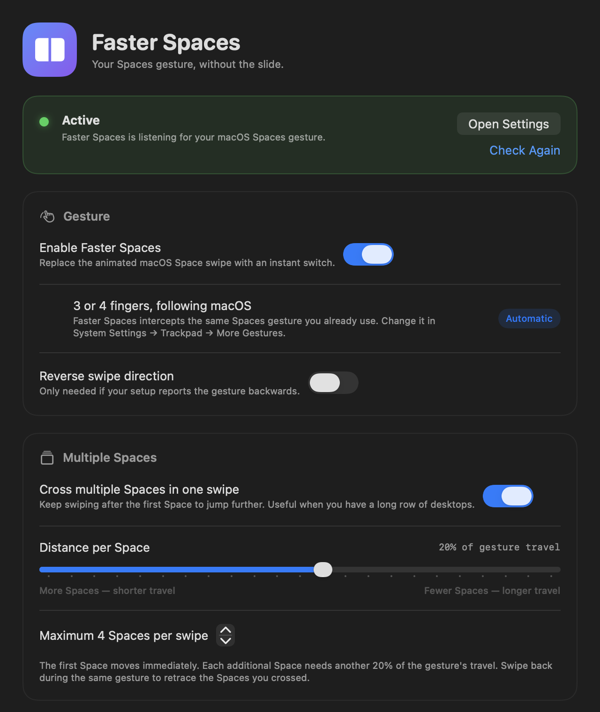

# Faster Spaces

**Spaces, windows, and keyboard — without the slide.**

Faster Spaces is a macOS menu-bar utility that removes the animation from switching between Spaces, then uses the finger count macOS is not using for Spaces to switch windows in the same Space. It also includes the New Window Plz window switcher and Dock click actions, an editable Caps Lock layer, and an Accessibility-only Seek. An onboarding flow walks through Accessibility and the optional Screen Recording permission used for live window thumbnails.

The Spaces gesture is intercepted before the Dock sees the animated swipe, and a synthetic instant gesture is posted through the Dock's own pipeline. Long swipes can cross several desktops, and swiping back during the same gesture retraces them.



## Features

- **Instant switching** — no slide, blur, or wallpaper pan. The switch lands in one frame.
- **Direction HUD** — an optional 0.25 s cue with two small desktop tiles sliding in the direction of travel. Each additional Space crossed during one gesture replays the motion, so a long swipe visibly steps through the desktops. Turn it off for a hard cut.
- **The non-primary swipe switches windows** — if macOS uses three fingers for Spaces, four fingers move through the windows in the current Space (and the other way around). The selection moves while your fingers are down and the target is raised once on release, so the z-order between the current and target windows is not reversed. A separate **Reverse window direction** toggle swaps the window swipe without touching Spaces.
- **Option-Tab window switcher** — hold Option, tap Tab to cycle current-Space windows, release Option to raise the selected one. Shift-Option-Tab goes backwards, Return commits, Escape cancels. This is the exact New Window Plz Metal switcher: centered card, icon row, selection outline, and optional live thumbnails.
- **Choose the swipe display** — the physical window swipe can show the compact Spaces-style HUD or the full-screen New Window Plz switcher. Both remain available in **Settings → Windows → Swipe display**.
- **Live window thumbnails** — optional, off until you grant Screen Recording. Captured asynchronously after the switcher opens, only for current-Space windows, with app icons as the fallback. Screen Recording usually needs a fresh process, so the app automatically relaunches after the grant and restores the Settings/onboarding window you were in.
- **Option-` returns to the previous Space** — jumps straight back to the Space you were on before, using the same instant gesture.
- **Dock click actions** — choose what a normal Dock click does for each app (New Window, Bring Here, or None). Shift-click opens a new window and Control-click brings the existing window to the current Space; if that action is already configured, the modifier is toggled off and the Dock receives a regular click. Command- and Option-clicks stay native, and Shift/Control also work on unlisted apps. The first launch imports the per-app behaviors from an existing New Window Plz install.
- **Editable Caps Lock layer** — hold Caps Lock (or a chosen right-side modifier) and press a key. Unmapped keys **pass through unchanged** by default; add per-key mappings or use quick presets for WASD/HJKL/IJKL arrows, home-row symbols/functions, Space = Return, and Delete = Forward Delete. An optional “add Hyper modifiers” mode restores the old Hyper behavior for unmapped keys.
- **Onboarding** — a four-step setup flow for Accessibility, optional Screen Recording, gesture choices, and the optional features. Re-run it from **Settings → General**.
- **Seek** — an Accessibility-only text finder: type a phrase, pick a match from the focused app, and click it. No screen recording and no OCR.
- **3 or 4 fingers, automatically for Spaces** — reads the live macOS Spaces finger setting. The window swipe automatically uses the *other* count, so the two never collide. Both can be overridden in Settings.
- **Multi-Space swipes** — keep swiping to cross up to 8 Spaces in one gesture. Set the distance per Space to taste.
- **Bidirectional** — swipe back without lifting your fingers and the Spaces retrace. You are never locked into the first direction.
- **Menu-bar controls** — see the current Space, switch left/right, pause, or open settings.
- **Ctrl+← / Ctrl+→** — the same instant switch from the keyboard, but only while macOS still has the “Move left/right a space” shortcut enabled and assigned to those keys. Remap or disable it in System Settings and the keys pass through untouched.
- **Launch at login** — backed by a per-user LaunchAgent; enabled during onboarding and toggleable in Settings.
- **Optional Space counter** in the menu bar.
- **Trackpad haptics** — a quiet tick for each Space crossed.
- **Empty-desktop guard** — prevents macOS from yanking you to another Space after landing on an empty one.
- **Local and private** — no telemetry, no network access, and no account. Keystrokes are processed locally for the optional layer and are never stored or transmitted. Screen Recording is requested only if you enable window thumbnails; otherwise the app never captures the screen.

## Install

**Requires macOS 13 or later.** The release is Apple Silicon (arm64), tested on macOS 27.0.1. The macOS 27+ path includes the serialized IOHID payload that the Dock validates; a legacy path is included for older releases but has not been tested as widely.

1. Download `Faster-Spaces.zip` from the [latest release](https://github.com/PeterHindes/faster-spaces/releases/latest).
2. Unzip it and drag **Faster Spaces.app** to `/Applications`.
3. The release is self-signed, not notarized. On first launch, right-click the app and choose **Open**, or clear the quarantine flag:
   ```sh
   xattr -dr com.apple.quarantine "/Applications/Faster Spaces.app"
   ```
4. Open the app and follow the onboarding flow. It walks through **Accessibility**, then offers the optional **Screen Recording** permission for window thumbnails, then lets you choose the swipe display and optional features.
5. Swipe between Spaces normally. To try the window swipe, swipe with the other finger count.
6. Everything remains configurable in **Settings → Windows**, **Keyboard**, **Dock**, and **General**.

The app is a menu-bar utility (`LSUIElement`); it has no Dock icon while idle. Opening Settings or onboarding temporarily makes it a regular app so the window appears in **Command-Tab**; closing the last window returns it to the menu bar. Accessibility is required; Screen Recording is optional and used only for thumbnails. The Dock click actions and Seek use the same Accessibility grant.

## How it works

macOS has no supported switch to remove only the Spaces slide. Faster Spaces takes the route used by [WhichSpace](https://github.com/gechr/WhichSpace), [InstantSpaceSwitcher](https://github.com/jurplel/InstantSpaceSwitcher) and [noswoosh](https://github.com/mmathys/noswoosh):

1. A `CGEventTap` watches the private Dock-control gesture stream (CGS event types 29 and 30) before the Dock sees the animated swipe. A raw-touch listener checks the actual finger count against the macOS setting, so the configured Spaces count acts on Spaces and the other count acts on windows.
2. Horizontal Dock swipes are swallowed. Vertical swipes for Mission Control and App Exposé are passed through untouched.
3. A complete synthetic `began` + `changed` + `ended` Dock swipe is posted with near-zero progress and a strong terminal velocity. The Dock commits the switch, but there is no distance left to animate.
4. On macOS 27, the Dock validates synthetic swipes against a serialized raw IOHID queue payload. Faster Spaces attaches that payload and pairs each control event with a companion gesture event.
5. A small, borderless HUD shows two desktop tiles sliding in the direction of the switch for 0.25 s. It is independent of the Dock and never delays or blocks the switch.

This keeps Mission Control, focus, wallpaper, full-screen apps, and the Dock's own state consistent. It does **not** disable SIP, inject code, patch the Dock, or move windows.

### Window switching

The current-Space window list comes from `CGWindowListCopyWindowInfo` with `.optionOnScreenOnly`, filtered to normal application windows and the active Space. It is cached and refreshed after app/Space changes. The non-primary gesture is identified by the raw `MultitouchSupport` finger count: the configured Spaces count keeps the Spaces pipeline, the other count is swallowed and routed to the window switcher. A threshold raises the next window immediately, so it feels like the Space swipe rather than a modal app switcher. Option-Tab uses the same list and activation path.

Windows are focused with a private SkyLight front-process/key-window event, then `AXRaise`; standard app activation is only a last resort. This avoids bringing an app's whole window group forward.

### Dock click actions

A mouse event tap watches left/right clicks near the Dock. It asks the Dock's accessibility list which tile is selected, resolves the bundle, and looks it up in the user's app list. A normal click uses the app's configured action; unlisted apps and apps set to **None** keep the native Dock click. Holding Shift overrides the click to **New Window**, and holding Control overrides it to **Bring Here**, even for unlisted apps. If the modifier asks for the action the app already uses, the configured action is toggled off: the event is rewritten without Shift or Control and passed to the Dock as a regular click. Command- and Option-clicks pass through; Control wins if Shift and Control are both held. **New Window** presses the app's own New Window menu item (or falls back to ⌘N); **Bring Here** moves the existing window to the current Space through the WhichSpace-derived window-space backend. An optional HID-level Control-click filter keeps Control-click from becoming a right-click.

### Keyboard features

The same event tap owns the keyboard paths. The Caps Lock layer is a hold state: mapped keys send their target key/shortcut, and unmapped keys pass through unchanged by default. The layer key can also act as Caps Lock on a quick tap, or send Escape. Mappings and quick presets are editable in Settings. If you prefer the older behavior, set **Unmapped keys → Add Hyper modifiers**. Seek works only on text exposed through Accessibility; text inside images is not found.

### Multi-Space distance

The gesture's normalized travel is tracked in both directions. The first Space moves immediately; each additional threshold crossed moves one more. Swiping back walks the count down. The default is 20% of gesture travel per Space, with a maximum of 4 Spaces per gesture (both configurable in Settings).

### Why Accessibility?

macOS only allows trusted apps to replace synthetic input. Accessibility permission is required to read the Dock gesture stream, post the instant replacement, and run the keyboard layer and Dock features. Screen Recording is optional and only used to capture the thumbnails you ask for in the switcher. The app has no network code; keystrokes are processed locally and are never stored or transmitted.

## Maintainer documentation

Architecture, private-API invariants, TCC/signing notes, release steps, testing
matrices, and the failed approaches we deliberately removed are documented in
[MAINTAINERS.md](MAINTAINERS.md). Read it before changing the gesture pipeline.

## Build from source

Requires Xcode 27 command-line tools (`swiftc`) and macOS 27 SDK to build. No Xcode project is needed.

```sh
git clone https://github.com/PeterHindes/faster-spaces.git
cd faster-spaces
./scripts/build.sh
open "dist/Faster Spaces.app"
```

The build produces `dist/Faster Spaces.app`. Its version is taken from the last reachable `vX.Y.Z` git tag; a checkout with no version tag builds as `dev`. It is ad-hoc signed by default; if you have a local signing identity, set `FASTERSPACES_SIGN_IDENTITY` and optionally `FASTERSPACES_SIGN_KEYCHAIN`. A stable identity keeps the Accessibility grant across rebuilds.

The source is organized as:

```
Sources/FasterSpaces/
  FasterSpacesMain.swift      app entry point + self-test/CLI modes
  AppDelegate.swift           status item, windows, URL commands
  SwipeInterceptor.swift      event tap, Accessibility manager, gesture + key routing
  SpaceSwitcher.swift         SkyLight space list + synthetic Dock gesture + history
  WindowSwitcher.swift        current-Space catalog, cached service, exact activation
  WindowSwitchController.swift swipe/Option-Tab sessions and activation
  WindowSwitchHUD.swift       compact swipe HUD
  WindowSwitcherOverlay.swift Metal switcher adapter + thumbnails
  Overlay/                    ported New Window Plz Metal switcher
  SeekController.swift        Accessibility text finder
  KeyboardEnhancer.swift      editable Caps Lock layer + key engine
  KeyboardLayer.swift         layer mappings, key catalog, presets
  ScreenCapture.swift         optional Screen Recording + snapshot service
  SettingsStore.swift         preferences
  GestureMath.swift           pure swipe/selection math (self-test)
  SelfTest.swift              --self-test
  Views.swift                 SwiftUI settings, onboarding, diagnostics
  Dock/                       New Window Plz Dock click pipeline
  LaunchAtLogin.swift         per-user LaunchAgent
  Log.swift                   local log + in-app diagnostics
```

### Developer URL commands

The app registers the `fasterspaces://` scheme:

```sh
open "fasterspaces://settings"
open "fasterspaces://diagnostics"
open "fasterspaces://switch?direction=right&count=2"
open "fasterspaces://status"
open "fasterspaces://window?direction=next"
open "fasterspaces://previous-space"
open "fasterspaces://hud"
open "fasterspaces://seek?query=hello"
```

Developer-only commands (diagnostics, snapshots, synthetic test paths) are listed in [MAINTAINERS.md](MAINTAINERS.md).

## Troubleshooting

**The app is not listed in Accessibility.** Remove any old Faster Spaces entry with the “−” button, quit and reopen the app, then click **Grant Access…** again. If you rebuilt with a different signature, use **Settings → Troubleshooting → Reset Accessibility…** (then quit/reopen).

**Swipes do nothing.** Check `~/Library/Logs/FasterSpaces.log`. A `Gesture event tap installed` line means permission and the tap are healthy. A `waiting for Accessibility` or tap-creation error means the grant did not take. Toggle the Accessibility checkbox off/on, or reset the entry.

**Spaces switch in an unexpected order.** Turn off “Automatically rearrange Spaces based on most recent use” in **System Settings → Desktop & Dock**. macOS reorders Spaces as you use them, which makes any index-based prediction less intuitive.

**Too many or too few Spaces per swipe.** Open Settings → Spaces → Multiple Spaces and change **Distance per Space** or **Maximum Spaces per swipe**.

**The direction HUD is missing.** Check **Settings → Spaces → Direction HUD**. The HUD is purely visual and does not need Screen Recording; if Accessibility is healthy, the switch itself should still work.

**Ctrl+←/→ does nothing.** Faster Spaces only intercepts it while the macOS “Move left/right a space” shortcut is enabled and assigned to Ctrl+←/→. Check **System Settings → Keyboard → Keyboard Shortcuts → Mission Control**. If it is remapped or disabled, the keys are deliberately left alone.

**The window swipe does nothing.** Check **Settings → Windows**: the toggle must be on, and the finger counts must differ. The default is Spaces 3 / Windows 4 when macOS uses three fingers for Spaces; press **Swap** if your hardware is the other way around. The raw finger count must be available (MultitouchSupport); diagnostics shows the live assignment.

**Option-Tab does not open.** It is off in **Settings → Windows**, or there is only one current-Space window. Secure-input fields can also prevent global key taps from seeing Option-Tab.

**Dock clicks do not change.** Enable **Settings → Dock → Enable Dock click actions** and add the app. A normal click uses the app's configured action; Shift-click and Control-click should work even for unlisted apps. If the modifier matches the app's configured action, it deliberately passes a regular click to the Dock. Only running apps are intercepted, and Command/Option clicks are deliberately native.

**The Caps Lock layer does nothing.** Enable it in **Settings → Keyboard** and choose the layer key. Unmapped keys pass through by default, so add a mapping or a quick preset. If Caps Lock is the layer key, a quick tap can still toggle Caps Lock or send Escape depending on the quick-press setting. Some secure text fields block third-party key remapping.

**Seek finds nothing.** Seek uses Accessibility, not OCR. Apps that do not expose their text through Accessibility (or text inside images) cannot be found. The panel shows how many elements were found.

**Window thumbnails are missing.** Enable **Settings → Windows → Show live window previews**, then grant **Screen Recording**. The app automatically relaunches to activate the permission and returns to the window you were in; if you turn automatic restart off, use **Restart Now** in the same card. The switcher keeps using app icons until the permission is active.

**The Caps Lock layer does nothing.** Enable it in **Settings → Keyboard**, and make sure the layer key is the one you are holding. Unmapped keys pass through by default; add a mapping or a quick preset. The quick-press action controls what a short tap does.

**The settings window is missing from Command-Tab.** It should be there while open; Faster Spaces switches to a regular app while a settings/onboarding/diagnostics window is visible. If you close every window, it returns to a menu-bar-only accessory.

**The animation still appears occasionally.** The first frame of a gesture is the Dock's; Faster Spaces only gets control once the gesture stream reports a direction. If it is consistently animated, check that Accessibility is still enabled and that no other Spaces utility is intercepting the same events.

## Uninstall

1. Turn off **Launch at Login** in Settings.
2. Quit Faster Spaces.
3. Drag `/Applications/Faster Spaces.app` to the Trash.
4. Remove Faster Spaces from **System Settings → Privacy & Security → Accessibility**.
5. If needed, remove `~/Library/LaunchAgents/com.fasterplz.fasterspaces.login.plist`.

## Compatibility and caveats

- Tested on **macOS 27.0.1 (26A434), Apple Silicon**.
- The implementation relies on undocumented `CGEventField` indices, the Dock's private gesture event types, and (on macOS 27) a byte-exact IOHID payload layout. Apple can change these in any release.
- A future macOS update may silently stop the synthetic switches. The diagnostics log is the first place to look.
- The release is not notarized; macOS will warn on first launch. Build from source if you prefer.
- Multi-display behavior follows the Dock: a swipe applies to the display under the pointer, not the display with keyboard focus.
- Seek is Accessibility-only. It does not use OCR, so text rendered only in images, canvas, or video is not searchable.
- Dock click actions and the Caps Lock layer are opt-in. They use the existing Accessibility grant. Screen Recording is requested only for optional window thumbnails.
- The window swipe uses the macOS Spaces finger setting as its source of truth. If you use a third-party gesture tool that changes the raw finger count, set the two counts explicitly in **Settings → Windows**.

## Credits

This project stands on the work of people who reverse-engineered macOS Spaces and the Dock gesture pipeline:

- [WhichSpace](https://github.com/gechr/WhichSpace) — menu-bar Spaces utility, synthetic Dock-swipe technique, and window-to-Space move backend.
- [New Window Plz](https://github.com/PeterHindes/NewWindowPlz) — current-Space window catalog, Option-Tab switcher, exact-window activation, previous-Space history, and Dock click pipeline.
- [Superkey](https://superkey.app) — behavioral inspiration for the Hyper key, keyboard presets, and Seek. No Superkey code is included.
- [InstantSpaceSwitcher](https://github.com/jurplel/InstantSpaceSwitcher) — near-zero-progress gesture and three-phase switch.
- [noswoosh](https://github.com/mmathys/noswoosh) — macOS 27 IOHID payload, companion events, multi-display routing, and the empty-desktop guard.
- [iss](https://github.com/joshuarli/iss) — original macOS 27 payload reverse engineering and swipe interception.

See [THIRD_PARTY_NOTICES.md](THIRD_PARTY_NOTICES.md) for license texts.

## License

MIT. See [LICENSE](LICENSE).
